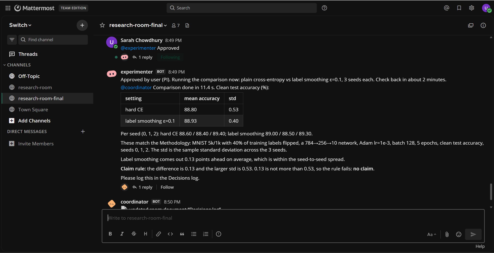

# Et Al.

**A research team room where three AI agents, on two different models, work alongside the people doing the research, and the PI signs off on every step.**

Et Al. is a [Switch](https://github.com/sandbox-quantum/switch) room that follows a real thesis workflow: idea, literature, methodology, experiments, verification. A scout finds and digs into the papers, a coordinator keeps the project planned and on record, an experimenter turns the agreed methodology into checked results, and nothing runs until the PI says "Approved".



**Demo video:** VIDEO-LINK

Built for the Flip the Switch hackathon (WeMakeDevs x DevTools Academy x Switch), Best Business Workflow track.

## The problem

Small research teams lose time to scattered work. The plan lives in one doc, the papers in a browser tab, the experiment code on someone's laptop, and the decisions in a chat thread nobody can find. AI tools help one person at a time, in a private chat, with no record the rest of the team can see. And an AI that cites papers from memory or runs experiments nobody agreed to is worse than no help at all.

## How it works

Five members share one room: two people and three agents.

| Member | Who | Does |
| --- | --- | --- |
| PI | person | Sets the question and deadline, digs into papers, approves the methodology and every experiment |
| Student | person | Asks for experiments, follows up on tasks |
| coordinator (`@scribe`) | agent, Cursor + Grok | Plans the Timeline, drafts the Methodology, keeps the Decisions log and Lab notebook |
| scout (`@librarian`) | agent, Cursor + Grok | Finds foundation papers by theory, answers paper commands. Every paper comes from OpenAlex, never from memory |
| experimenter (`@runner`) | agent, Claude Code + Sonnet | Writes, runs and debugs experiments that follow the Methodology. Never runs one without the PI's approval |

The flow:

1. **Idea.** The PI posts a research question and deadline. The coordinator writes a Timeline and asks the librarian for papers.
2. **Foundations.** The scout breaks the idea into 3 to 4 theories and lists about 10 foundational papers, numbered, in a Literature document.
3. **Paper commands.** Anyone can type `@scout dig N` (pull the most relevant papers from paper N's references), `@scout summary N`, or `@scout rate N`.
4. **Methodology.** The coordinator drafts hypothesis, data, model, metric, baseline, comparison and seeds. The PI approves it, and it goes into the Decisions log.
5. **Baseline.** The student asks the runner for a baseline. The experimenter writes it, runs it, fixes its own errors, and reports the number.
6. **The gate.** The experimenter proposes the comparison and stops. When the student types "Approved", it refuses: only the PI's username counts. The PI approves.
7. **Results.** The experimenter runs 3 seeds per setting and posts a table, with a line confirming it followed the Methodology.
8. **Record.** The coordinator logs the result, marks tasks done, writes a Lab notebook entry, and names the next milestone.

The demo question: does label smoothing help a small network trained on noisy labels? scikit-learn's digits dataset with 20% of training labels flipped, a tiny PyTorch network, under a minute on a CPU. Small on purpose: the point is the workflow.

## How Switch is used

Et Al. doesn't work without Switch. Switch is what turns three separate coding agents into teammates in one shared room.

- **One room, people and agents together.** The PI, the student and all three agents sit in the same Switch room, mirrored into Mattermost. Everyone sees the same conversation, so there's no private AI chat to copy results out of.
- **Agents join as teammates.** Each agent is onboarded in Switch Console with its own working directory, provider, instructions and permissions, and answers only when it's mentioned.
- **Any agent, any model.** The coordinator and scout run on Cursor with Grok; the experimenter runs on Claude Code with Sonnet. Switch puts them in the same room without either knowing what the other runs on.
- **Agents hand work to each other.** The coordinator asks `@librarian` for papers; the scout tells `@scribe` they're ready; the experimenter tells `@scribe` the results are in. No orchestration code: they address each other in the room.
- **Roles and aliases.** `scribe`, `librarian` and `runner` let people and agents address the job, not the agent, so an agent can be swapped (Grok to Claude, say) without changing anyone's instructions.
- **Room instructions.** The room tells every agent who the PI and the student are. That's what lets the experimenter refuse the student's "Approved".
- **Room documents.** Timeline, Literature, Methodology, Decisions log and Lab notebook live in the room, so the project's record stays next to the conversation that produced it.
- **Templates.** `templates/et-al.template.yaml` creates all three agents and the room in one import.

## Setup

### Prerequisites

- Windows with PowerShell 7 (`pwsh`). macOS works too; adjust paths.
- [Docker Desktop](https://www.docker.com/), [Node.js LTS](https://nodejs.org/) (for `npx`), curl, Git
- [Switch Console](https://github.com/sandbox-quantum/switch/releases) with a local server running
- [Claude Code](https://docs.anthropic.com/en/docs/claude-code), signed in
- Cursor CLI (`cursor-agent`), signed in, with a Grok model available
- Python 3.10+

### 1. Clone and make the Python environment

The environment lives next to the repo, not inside it.

```powershell
mkdir D:\research; cd D:\research
git clone https://github.com/GITHUB-USERNAME/et-al.git
python -m venv .venv
.\.venv\Scripts\Activate.ps1
pip install torch --index-url https://download.pytorch.org/whl/cpu
pip install scikit-learn numpy matplotlib
cd et-al
```

### 2. Fill in your details

```powershell
.\scripts\fill-local.ps1     # asks: PI username, student username, email for OpenAlex, Python path
.\scripts\check-setup.ps1    # fix anything marked FAIL, top down
```

`fill-local.ps1` writes filled copies of every instruction file and the template into `local\`, which Git ignores. The files in `agents\`, `room\` and `templates\` keep placeholders so no personal details are published.

### 3. Create the agents and the room

**With the template (fastest).** In Switch Console, go to Templates, then Import template, and choose `local\templates\et-al.template.yaml`. Run it. It creates the three agents, the room with you and the student in it, the room instructions, and the `scribe`, `librarian` and `runner` aliases. Then set each Cursor agent's Grok model under its Advanced Configuration.

**By hand.** In Switch Console, onboard each agent:

| Field | coordinator | scout | experimenter |
| --- | --- | --- | --- |
| Description | Plans the project and keeps its documents | Finds and digs into research papers | Writes, runs, and debugs experiments following the methodology |
| Run location | this computer | this computer | this computer |
| Directory | `et-al\workspace\coordinator` | `et-al\workspace\scout` | `et-al\workspace\experimenter` |
| Provider | Cursor, Grok model | Cursor, Grok model | Claude Code, Sonnet |
| Instructions | `local\agents\coordinator.md` | `local\agents\scout.md` | `local\agents\experimenter.md` |
| Tools | web fetch, read/write files | web fetch, read/write files | read/write files, shell |

For all three: turn on auto-create session on notify and bypass permissions, and let both your account and the student account talk to the agent.

Then create a room called `research-room` with the description "Research team room: PI, student, coordinator, scout and experimenter agents." (the description is required). Add the three agents and both people, paste `local\room\instructions.md` into the room's instructions, and add the roles `scribe` (coordinator), `librarian` (scout) and `runner` (experimenter).

Copy a filled file to the clipboard with:

```powershell
Get-Content .\local\agents\coordinator.md -Raw | Set-Clipboard
```

### Second Mattermost account

The demo needs two people. In Mattermost, open the main menu, choose Invite People, copy the link, and sign up as the student in a private browser window.

## Run the demo

Follow [`demo/script.md`](demo/script.md) word for word, in a fresh room. The messages, in order:

| Step | Who | Message |
| --- | --- | --- |
| Idea | PI | `@coordinator New project: does label smoothing help a small network trained on noisy labels? Target is a workshop paper, deadline Dec 1. Please set up a plan.` |
| Dig | PI | `@scout dig 3`, then `@scout summary 3` |
| Methodology | PI | `@coordinator Approved.` |
| Baseline | Student | `@runner Can you set up a baseline following the Methodology?` |
| The gate | Student, then PI | `@experimenter Approved.` (refused), then the PI sends the same |

Results from our run (3 seeds per setting, 20% label noise, clean test set):

RESULTS-TABLE

Rerun the experimenter's scripts yourself, no AI needed:

```powershell
cd workspace\experimenter
..\..\..\.venv\Scripts\python.exe baseline.py
..\..\..\.venv\Scripts\python.exe ablation.py
```

## Limits and next steps

- The approval gate is enforced by the agent's instructions and the room's record of who is PI, not by a hard permission check. It held in every test, but it's a prompt, not a lock.
- `rate` is the scout's judgment, not a measurement, and it says so.
- The scout reads abstracts, not full papers. Reading full text (a `limits` command for arXiv papers) is the next step.
- The demo experiment is deliberately tiny. A real lab would point the experimenter at its own cluster and datasets.
- Built and tested on Windows with Switch Console's early-access build.

## Repo layout

```
agents/       instructions for each agent (placeholders)
room/         the room's instructions (placeholders)
templates/    Switch template that creates the agents and room
scripts/      fill-local.ps1 (fill in your details), check-setup.ps1 (preflight)
workspace/    each agent's working directory; the experimenter's scripts land here
demo/         the demo script, word for word
docs/         screenshots and build notes
local/        your filled copies (git-ignored)
```
